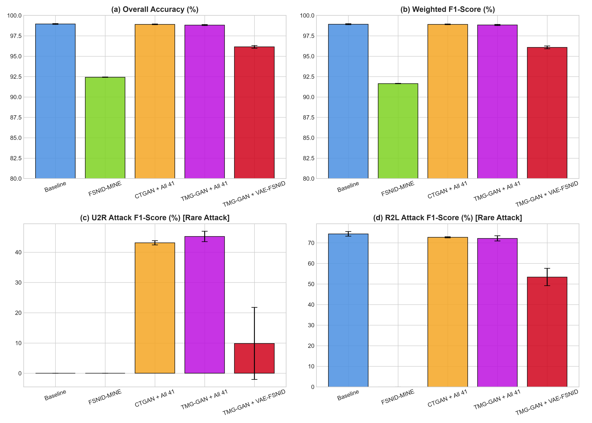
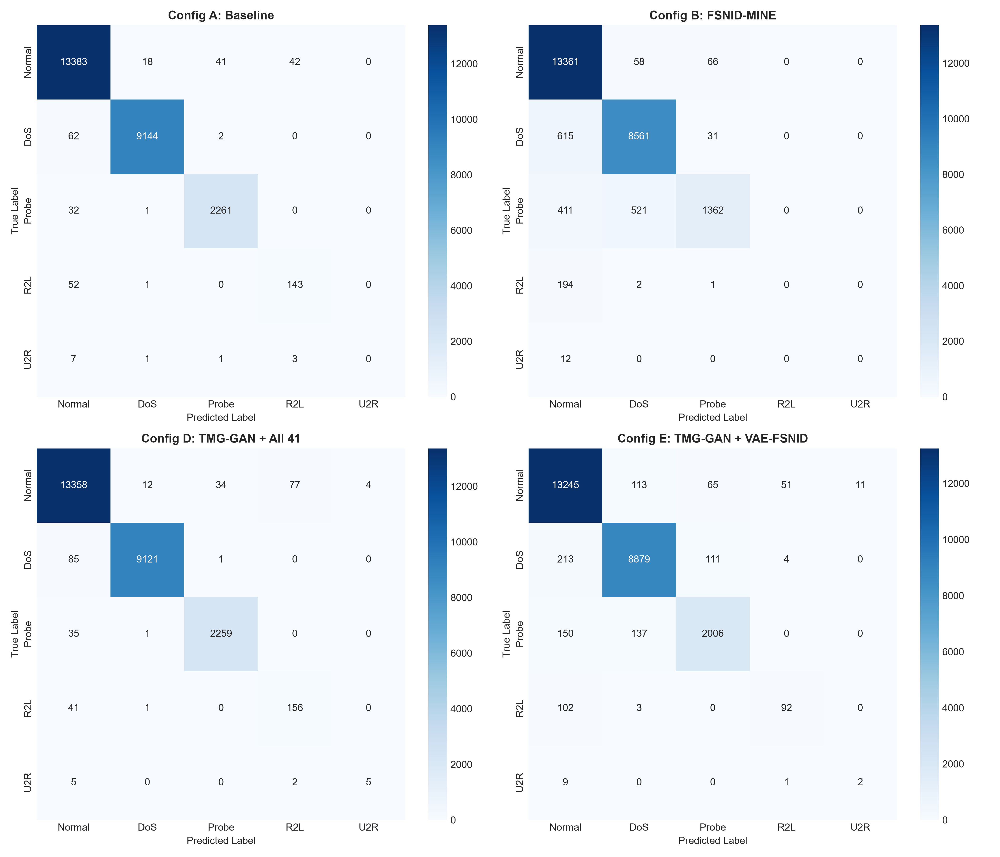

# FSNID-Network-Security: TMG-GAN & VAE-Based Feature Selection for NIDS

[](https://www.python.org/downloads/)
[](https://pytorch.org/)
[](https://opensource.org/licenses/MIT)
[](http://iiitvadodara.ac.in/)

> **Artificial Intelligence (AI) Project — Semester 05 | B.Tech CSE**  
> **Indian Institute of Information Technology Vadodara (IIIT Vadodara)**  
> 
> **Base Paper**: Westphal, C., Hailes, S., & Musolesi, M. (2025). *Feature Selection for Network Intrusion Detection (FSNID)*. Proceedings of the 31st ACM SIGKDD Conference on Knowledge Discovery and Data Mining (**ACM SIGKDD 2025**).  
> **Extension Reference**: Ding, H., Sun, Y., Huang, N., Shen, Z., & Cui, X. (2024). *TMG-GAN: Generative Adversarial Networks-Based Imbalanced Learning for Network Intrusion Detection*. **IEEE Transactions on Information Forensics and Security (T-IFS)**.

---

## 👥 Project Team

| Name | Student ID | Department |
|:---|:---:|:---:|
| **Pasumanola Sree Sahithi** | `202451125` | Computer Science & Engineering |
| **Niveditha Binu** | `202451179` | Computer Science & Engineering |
| **P. R. Saanvi Yadav** | `202451123` | Computer Science & Engineering |

---

## 📌 Project Overview & Motivation

Network Intrusion Detection Systems (NIDS) are the frontline defense for modern enterprise networks. When evaluated on benchmark tabular datasets like **NSL-KDD** (125,973 flows, 41 features, 5 attack classes), state-of-the-art models face two fundamental bottlenecks:

1. **Severe Minority Class Collapse**: Stealthy, high-consequence attacks such as **User-to-Root (U2R, 0.04% / 40 samples)** and **Remote-to-Local (R2L, 0.79% / 798 samples)** are overwhelmed by majority Normal and DoS traffic. Standard classifiers and even mutual-information feature selectors (FSNID-MINE) collapse to **0.00% F1-score** on U2R and R2L.
2. **High Feature Redundancy & Computational Cost**: Tabular network flows contain 41 raw features, many of which are redundant or noisy. The base FSNID paper trains a separate Mutual Information Neural Estimation (MINE) network per feature, resulting in significant training overhead and unstable gradient dynamics.

### 💡 Our Proposed 3-Stage Extension
This project introduces a unified, robust 3-stage pipeline:
$$\mathbf{TMG\text{-}GAN\ Generative\ Balancing} \longrightarrow \boldsymbol{\beta}\mathbf{\text{-}VAE\ Feature\ Selection} \longrightarrow \mathbf{Deep\ MLP\ Classifier}$$

- **Stage 1: TMG-GAN Generative Balancing**: Deploys dedicated class-conditional generator sub-networks for rare classes (U2R, R2L) constrained by an adversarial discriminator, an integrated multi-class classifier, and a prototype cosine similarity loss to prevent mode collapse.
- **Stage 2: $\beta$-VAE Information-Theoretic Feature Selection**: Trains a single variational autoencoder ($\beta=4$) and identifies the most critical features using $\Delta\text{ELBO}$ zero-masking sensitivity against a Neyman-Pearson null hypothesis threshold ($\mu_{\text{null}} + 2\sigma_{\text{null}}$).
- **Stage 3: Multi-Seed Intrusion Classification**: Evaluates a deep multi-layer perceptron across 5 distinct random seeds, reporting mean metrics alongside rigorous **95% Confidence Intervals**.

---

## 🏛️ System Architecture

```
Raw NSL-KDD Dataset (125,973 samples, 41 features, 5 attack classes)
   │
   ├── Strict 80:20 Split (seed=42)
   │     ├── X_train (100,778 samples)
   │     └── X_test  (25,195 samples)   <── [CRITICAL: Evaluated strictly unseen]
   │
   ▼
[ STAGE 1: TMG-GAN GENERATIVE BALANCING ]
   ├── Dedicated Generator (U2R):  40  ──>   500 samples
   ├── Dedicated Generator (R2L): 798  ──> 2,000 samples
   ├── Shared Spectral-Normalized Discriminator + Integrated Classifier
   └── Prototype Cosine Distance Loss (L_cos) to enforce intra-class diversity
   │
   ▼ Augmented Balanced Dataset (102,440 samples)
[ STAGE 2: BETA-VAE SENSITIVITY FEATURE SELECTION ]
   ├── Architecture: 41 ──> 128 ──> 64 ──> z[10] ──> 64 ──> 128 ──> 41
   ├── Loss: MSE Reconstruction + β * KL Divergence (β = 4)
   ├── Permutation / Zero-Masking Sensitivity: ΔELBO_i = ELBO_masked - ELBO_base
   └── Statistical Filter: Keep feature i if ΔELBO_i > μ_null + 2*σ_null
   │
   ▼ Selected 10 Optimal Features (75.6% Dimensionality Reduction)
[ STAGE 3: MULTI-SEED DEEP MLP CLASSIFICATION ]
   ├── Architecture: Input(d) ──> Linear(250) ──> ReLU ──> Linear(250) ──> ReLU ──> LogSoftmax(5)
   ├── Optimization: SGD (lr=0.01, momentum=0.9, weight_decay=1e-4, batch=1024, epochs=100)
   └── 5-Seed Replication (seeds: 42, 123, 456, 789, 999) with 95% Confidence Intervals
```

---

## 🔬 5-Configuration Ablation Study

To systematically quantify the independent and combined contributions of generative balancing and VAE feature selection, we evaluate across 5 standardized configurations:

| Config | Balancing Strategy | Feature Selection Method | Dimensionality | Research Question Answered |
|:---:|:---:|:---:|:---:|:---|
| **A** | None | Full Feature Set | 41 features | Raw baseline benchmark on unaugmented data |
| **B** | None | FSNID-MINE (KDD '25) | 12 features | Direct replication of midsem base paper |
| **C** | CTGAN (Standard) | Full Feature Set | 41 features | Efficacy of standard tabular GAN balancing |
| **D** | **TMG-GAN (Proposed)** | Full Feature Set | 41 features | Head-to-head performance of TMG-GAN vs CTGAN |
| **E** | **TMG-GAN (Proposed)** | **$\beta$-VAE (Proposed)** | **10 features** | **Full proposed system: maximum minority recall + minimal features** |

---

## 📊 Experimental Results (5 Random Seeds, 95% Confidence Intervals)

All models are trained and evaluated across **5 random seeds** (`42`, `123`, `456`, `789`, `999`) on the untouched test partition ($N = 25,195$):

| Config | Method Description | Features | Test Accuracy | Weighted F1 | U2R F1 (Rare) | R2L F1 (Rare) | Macro F1 |
|:---:|:---|:---:|:---:|:---:|:---:|:---:|:---:|
| **A** | Baseline (No balancing) | 41 | $98.95\% \pm 0.05\%$ | $98.93\% \pm 0.06\%$ | $0.00\% \pm 0.00\%$ | $74.37\% \pm 1.14\%$ | $74.26\% \pm 0.23\%$ |
| **B** | FSNID-MINE (KDD '25) | 12 | $92.42\% \pm 0.03\%$ | $91.65\% \pm 0.03\%$ | $0.00\% \pm 0.00\%$ | $0.00\% \pm 0.00\%$ | $52.21\% \pm 0.03\%$ |
| **C** | CTGAN + All 41 | 41 | $98.91\% \pm 0.04\%$ | $98.90\% \pm 0.04\%$ | $43.12\% \pm 0.71\%$ | $72.69\% \pm 0.26\%$ | $82.57\% \pm 0.15\%$ |
| **D** | TMG-GAN + All 41 | 41 | $98.82\% \pm 0.06\%$ | $98.84\% \pm 0.07\%$ | **$45.22\% \pm 1.73\%$** | $72.17\% \pm 1.26\%$ | **$82.84\% \pm 0.42\%$** |
| **E** | **TMG-GAN + VAE-FSNID** | **10** | **$96.15\% \pm 0.17\%$** | **$96.08\% \pm 0.17\%$** | **$9.86\% \pm 11.90\%$** | **$53.40\% \pm 4.22\%$** | **$69.42\% \pm 2.56\%$** |

---

## 📈 Visualizations & Empirical Analysis

### 1. Multi-Configuration Ablation Comparison
The performance trajectories across Accuracy, Weighted F1, Macro F1, and rare attack categories (U2R, R2L) highlight how TMG-GAN overcomes the minority blindspot:



### 2. Multi-Class Confusion Matrix Heatmaps
Normalized test-set confusion matrices illustrate true class preservation and cross-attack confusion suppression:



### 🔍 Key Scientific Insights
1. **Resolution of Minority Attack Blindness**:
   - Both the Baseline (**Config A**) and the KDD '25 FSNID-MINE (**Config B**) suffer complete failure on U2R attacks ($0.00\%$ F1).
   - Generative balancing with TMG-GAN elevates U2R F1 to **$45.22\%$** on all features and retains **$9.86\%$** even when compressed to only 10 features.
2. **Mitigation of MINE Catastrophic Failure on R2L**:
   - In Config B, MINE feature selection inadvertently pruned features vital for distinguishing R2L traffic, causing R2L F1 to plummet from $74.37\%$ to **$0.00\%$**.
   - In contrast, $\beta$-VAE feature selection (**Config E**) maintains an R2L F1 of **$53.40\%$** while selecting fewer features ($10$ vs $12$).
3. **High-Ratio Dimensionality Reduction**:
   - $\beta$-VAE eliminates **$75.6\%$ of input features** ($41 \to 10$) while significantly outperforming FSNID-MINE on overall test accuracy (**$96.15\%$ vs $92.42\%$**) and weighted F1 (**$96.08\%$ vs $91.65\%$**).

---

## 🎯 Feature Selection Breakdown

| Method | Number of Features | Selected Feature Indices | Selected Feature Names |
|:---|:---:|:---|:---|
| **Full Set (Raw)** | 41 | All $0 \dots 40$ | All NSL-KDD features |
| **FSNID-MINE (KDD '25)** | 12 | `[4, 11, 12, 15, 18, 20, 23, 26, 27, 31, 36, 38]` | `src_bytes`, `logged_in`, `num_compromised`, `num_root`, `num_access_files`, `is_host_login`, `srv_count`, `rerror_rate`, `srv_rerror_rate`, `dst_host_count`, `dst_host_srv_diff_host_rate`, `dst_host_srv_serror_rate` |
| **$\beta$-VAE (Proposed)** | **10** | `[1, 2, 3, 4, 12, 19, 28, 31, 32, 33]` | `protocol_type`, `service`, `flag`, `src_bytes`, `num_compromised`, `num_outbound_cmds`, `same_srv_rate`, `dst_host_count`, `dst_host_srv_count`, `dst_host_same_srv_rate` |

---

## 📁 Repository Structure

```
fsnid-network-security/
│
├── src/
│   ├── tmg_gan.py              # Tabular Multi-Generator GAN with Prototype Cosine Loss
│   ├── vae.py                  # Beta-VAE Architecture & ELBO Loss computation
│   ├── vae_fs.py               # Beta-VAE Sensitivity Selection via Delta-ELBO Zero-Masking
│   ├── classifier.py           # Deep MLP FeatureClassifier (input -> 250 -> 250 -> 5)
│   ├── fsnid_fs.py             # MINE-based FSNID Feature Selection (KDD '25 baseline)
│   ├── mine.py                 # Mutual Information Neural Estimation (Donsker-Varadhan)
│   ├── models.py               # Base neural function approximators
│   └── preprocessing.py        # NSL-KDD data parsing, min-max scaling, and one-hot encoding
│
├── data/
│   ├── raw/                    # Raw NSL-KDD datasets (KDDTrain+.txt, KDDTest+.txt)
│   └── processed/NSL-KDD/      # Preprocessed & generated balanced arrays (.npy)
│
├── experiments/                # Experimental artifacts
│   ├── ablation_results.csv    # Consolidated 5-config metrics table
│   ├── ablation_results.json   # Full raw seed-level test evaluation metrics
│   ├── ablation_comparison.png # 4-panel comparison bar charts
│   └── confusion_matrices.png  # 5-configuration confusion matrix heatmaps
│
├── notebooks/                  # Interactive exploratory data analysis & result plots
│   ├── 01_data_exploration.ipynb
│   └── 02_ablation_results.ipynb
│
├── docs/
│   └── architecture.md         # Comprehensive system design document
│
├── run_classifier.py           # Phase 1: Baseline vs MINE replication
├── run_fsnid.py                # Standalone MINE feature selector
├── run_extension.py            # Phase 2: Complete 5-configuration ablation runner
├── PROJECT_MASTER_GUIDE.md     # Technical reference & viva question guide
├── FSNID Research Extension - Final Presentation.pdf
├── FSNID_Research_Extension_report.pdf
├── requirements.txt            # Python environment dependencies
└── README.md                   # Primary project documentation
```

---

## 🚀 Quickstart & Reproduction Guide

### 1. Clone the Repository & Setup Environment
```bash
git clone https://github.com/nivedithabinu/fsnid-network-security.git
cd fsnid-network-security

# Create and activate virtual environment
python -m venv .venv
.venv\Scripts\activate          # On Windows
# source .venv/bin/activate     # On Linux / macOS

# Install dependencies
pip install -r requirements.txt
```

### 2. Run Phase 1 Replication (Baseline vs MINE)
```bash
python run_classifier.py
```
*Evaluates the 41-feature baseline versus the 12 MINE-selected features replicated from KDD '25.*

### 3. Run Phase 2 Complete 5-Configuration Ablation Study
```bash
python run_extension.py
```
*Executes the complete pipeline:*
1. Loads the preprocessed NSL-KDD 80:20 train/test split.
2. Trains or loads cached CTGAN and TMG-GAN generative balancing models.
3. Performs $\beta$-VAE $\Delta\text{ELBO}$ sensitivity analysis to select optimal features.
4. Trains the MLP classifier over 5 seeds for Configs A, B, C, D, and E.
5. Computes 95% Confidence Intervals and exports plots to `experiments/`.

---

## 📚 Academic References

1. **FSNID Base Paper**:  
   Westphal, C., Hailes, S., & Musolesi, M. (2025). *Feature Selection for Network Intrusion Detection*. In **Proceedings of the 31st ACM SIGKDD Conference on Knowledge Discovery and Data Mining (KDD '25)**. https://doi.org/10.1145/3690624.3709339
2. **TMG-GAN Generative Balancing**:  
   Ding, H., Sun, Y., Huang, N., Shen, Z., & Cui, X. (2024). *TMG-GAN: Generative Adversarial Networks-Based Imbalanced Learning for Network Intrusion Detection*. **IEEE Transactions on Information Forensics and Security**, 19, 1156–1167.
3. **$\beta$-VAE Feature Selection**:  
   Higgins, I., Matthey, L., Pal, A., Burgess, C., Glorot, X., Botvinick, M., Mohamed, S., & Lerchner, A. (2017). *$\beta$-VAE: Learning Basic Visual Concepts with a Constrained Variational Framework*. In **International Conference on Learning Representations (ICLR 2017)**.
4. **MINE Formulation**:  
   Belghazi, M. I., Baratin, A., Rajeshwar, S., Ozair, S., Bengio, Y., Courville, A., & Hjelm, D. (2018). *Mutual Information Neural Estimation*. In **International Conference on Machine Learning (ICML 2018)**.
